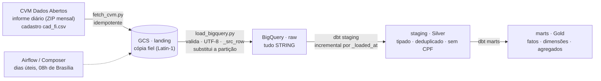

# 📈 CVM Fundos no BigQuery

[](https://github.com/ArthurTheWorld/cvm-bigquery-lakehouse/actions/workflows/ci.yml)


Pipeline de dados sobre os **dados abertos de fundos de investimento da CVM** (informe diário e
cadastro de fundos): download idempotente → **GCS** → **BigQuery** (raw) → **dbt** (staging e marts),
orquestrado por **Airflow / Cloud Composer** e provisionado com **Terraform**.

> ### ⚠️ Aviso sobre os dados
> **Nenhum dado real da CVM foi processado no desenvolvimento deste projeto**: o ambiente em que
> ele foi construído não alcança `dados.cvm.gov.br`. O pipeline foi validado com **dados sintéticos
> no schema oficial** (dicionários de dados da CVM), com defeitos injetados em quantidade
> conhecida. O download real está implementado e testado com um servidor HTTP falso, mas **não foi
> executado contra o portal**. Veja [Testes e validação](#testes-e-validação) para o que foi e o
> que não foi comprovado.

---

## Sumário

- [Arquitetura](#arquitetura)
- [O que o projeto demonstra](#o-que-o-projeto-demonstra)
- [Os dados](#os-dados)
- [Modelo de dados](#modelo-de-dados)
- [Estrutura do repositório](#estrutura-do-repositório)
- [Como executar](#como-executar)
- [Decisões de arquitetura](#decisões-de-arquitetura)
- [Testes e validação](#testes-e-validação)
- [CI](#ci)
- [Custo e desmontagem](#custo-e-desmontagem)
- [Limitações e próximos passos](#limitações-e-próximos-passos)
- [Créditos](#créditos)

---

## Arquitetura



| Camada | Dataset | Conteúdo | Acesso |
|---|---|---|---|
| Landing | bucket GCS | Arquivos originais, intactos | conta do pipeline |
| **raw** | `raw` | Tudo `STRING` + `_src_row`, `_src_file`, `_loaded_at`. **Contém CPF e nome de diretor** | **só a conta do pipeline** |
| **Silver** | `staging` | Tipado, deduplicado, **sem CPF** (LGPD: minimização) | pipeline |
| **Gold** | `marts` | Fatos, dimensões e agregados para BI | pipeline + conta de consumo |

## O que o projeto demonstra

| Recurso GCP / BigQuery | Onde |
|---|---|
| Landing no GCS e carga em BigQuery **idempotente por partição** (DELETE + INSERT em transação) | [`ingestion/load_bigquery.py`](ingestion/load_bigquery.py) |
| **Tolerância a mudança de schema** (coluna nova, removida e renomeada) | [`load_bigquery.py`](ingestion/load_bigquery.py), [`macros/columns.sql`](dbt_project/macros/columns.sql) |
| Tabelas **particionadas** (mês / dia) e **clusterizadas** | [`stg_inf_diario.sql`](dbt_project/models/staging/stg_inf_diario.sql), [`fct_fundo_dia.sql`](dbt_project/models/marts/fct_fundo_dia.sql) |
| dbt incremental com `insert_overwrite` e filtro por `_loaded_at` com janela de segurança | [`macros/incremental_filter.sql`](dbt_project/macros/incremental_filter.sql) |
| **BIGNUMERIC** para a cota (12 casas; `NUMERIC` truncaria em 9) | [`macros/types.sql`](dbt_project/macros/types.sql) |
| **Controle de custo**: `maximum_bytes_billed`, retenção, orçamento com alertas, Composer opcional | [`profiles.yml`](dbt_project/profiles.yml), [`infra/terraform/`](infra/terraform) |
| **IAM por dataset**, menor privilégio (o raw não é legível pelo consumo) | [`infra/terraform/main.tf`](infra/terraform/main.tf) |
| **LGPD por minimização de dados** (CPF vira hash, diretor é descartado) | [`stg_cad_fi.sql`](dbt_project/models/staging/stg_cad_fi.sql), [`dim_fundos.sql`](dbt_project/models/marts/dim_fundos.sql) |
| Cloud Composer (Airflow) com DAG idempotente | [`orchestration/dags/`](orchestration/dags) |
| CI com dbt em **datasets efêmeros** e limpeza com trava de segurança | [`.github/workflows/ci.yml`](.github/workflows/ci.yml), [`ci/bq_cleanup.py`](ci/bq_cleanup.py) |

## Os dados

**Fonte:** Portal de Dados Abertos da CVM — <https://dados.cvm.gov.br>.

| Conjunto | Formato | Uso |
|---|---|---|
| Informe diário de fundos | um ZIP por mês com um CSV | Fato: cota, patrimônio líquido, captação, resgate, nº de cotistas |
| Cadastro de fundos (`cad_fi.csv`) | CSV simples, 41 campos | Dimensão: nome, classe, administrador, gestor, taxas |

O que o projeto leu nos **dicionários de dados oficiais** e usa:

- Os CSVs são **Latin-1** (ISO-8859-1), separados por **`;`**.
- `VL_QUOTA` tem **12 casas decimais**. Isso importa no BigQuery, ver [decisões](#decisões-de-arquitetura).
- O dicionário do cadastro lista os campos em **ordem alfabética**, o que não garante a ordem das
  colunas no arquivo. Por isso a carga é por **nome de coluna**, nunca por posição.
- O informe usa o schema com `TP_FUNDO_CLASSE`, `CNPJ_FUNDO_CLASSE` e `ID_SUBCLASSE` (Resolução
  CVM 175). O pipeline também aceita os nomes antigos (`TP_FUNDO`, `CNPJ_FUNDO`), **por precaução**:
  esses nomes antigos seguem a memória do formato histórico e **não foram conferidos contra um
  arquivo real**.

**Premissa de projeto:** o arquivo do mês corrente muda ao longo do mês e fundos podem reapresentar
informes. Por isso o pipeline recarrega o mês inteiro a cada execução (se a premissa for falsa, o
custo é só uma recarga desnecessária).

### Dados sintéticos

[`ingestion/synthetic_cvm.py`](ingestion/synthetic_cvm.py) gera arquivos no **formato oficial** (Latin-1,
`;`, CRLF, 12 casas na cota, cadastro com 41 campos em ordem embaralhada). Nomes, CNPJs e CPFs são
**fictícios** (com dígitos verificadores válidos, como em qualquer gerador de dados de teste).
Ele injeta defeitos em **conjuntos disjuntos de fundos**, e a contagem exata de cada um é gravada
em `truth.json`:

| Defeito injetado | Para que serve |
|---|---|
| Reapresentação (mesma chave, valor corrigido, linha posterior) | Testar deduplicação: a última linha vence |
| Cota ≤ 0 · patrimônio líquido negativo | Testes de qualidade |
| Salto de cota (×2,2 por um dia) | Gera exatamente 2 retornos diários fora de ±50% |
| Fundos no informe e ausentes do cadastro | Cobertura do cadastro |
| Virada de schema entre meses (nomes antigos → novos) | Tolerância a mudança de schema |

## Modelo de dados

**Silver** (`dbt_project/models/staging/`): `stg_inf_diario` (incremental, `insert_overwrite` por
dia) e `stg_cad_fi` (último snapshot, uma linha por fundo).

**Gold** (`dbt_project/models/marts/`):

| Modelo | Grão | Destaque |
|---|---|---|
| `fct_fundo_dia` | fundo/classe (+ subclasse) por dia | Incremental, partição por dia, cluster por fundo; `captacao_liquida` |
| `agg_fundo_mensal` | fundo por mês | Patrimônio e cota de fechamento, fluxo, `rentabilidade_mes` |
| `agg_mercado_mensal` | mês × classe | Patrimônio e captação líquida; fundos sem cadastro aparecem como `SEM CADASTRO` |
| `agg_gestora_mensal` | gestor × mês | Patrimônio e captação líquida por gestora |
| `dim_fundos` | um fundo | Gestor PF **pseudonimizado**; sem CPF e sem diretor |
| `dim_gestoras` | um gestor | PJ pelo CNPJ; PF pelo hash do CPF |

## Estrutura do repositório

```text
.
├── ingestion/
│   ├── cvm_files.py          # URLs candidatas, download tolerante a 404, ZIP, decodificação Latin-1
│   ├── fetch_cvm.py          # baixa a CVM e deposita no disco ou no GCS (idempotente, valida o conteúdo)
│   ├── load_bigquery.py      # GCS -> BigQuery raw: UTF-8, _src_row, schema drift, partição substituída
│   └── synthetic_cvm.py      # dados sintéticos no schema oficial, com defeitos e verdade conhecida
├── dbt_project/
│   ├── models/staging/       # Silver
│   ├── models/marts/         # Gold
│   ├── macros/               # tipos · colunas tolerantes · filtro incremental · nomes de dataset
│   └── tests/                # 4 testes singulares (severity warn)
├── orchestration/dags/       # DAG do Airflow + lógica das tarefas (sem dependência de Airflow)
├── infra/terraform/          # bucket, datasets, IAM, orçamento, Composer (opcional)
├── ci/bq_cleanup.py          # derruba datasets efêmeros do CI (com trava de segurança)
├── tests/                    # pytest + harness de validação dos modelos em DuckDB
├── requirements.txt          # operar o pipeline (dbt-bigquery, clientes do Google)
├── requirements-dev.txt      # rodar os testes
└── requirements-harness.txt  # rodar o harness (dbt-duckdb), em ambiente separado
```

## Como executar

### Nível 1 — sem nenhuma conta

```bash
git clone https://github.com/ArthurTheWorld/cvm-bigquery-lakehouse.git
cd cvm-bigquery-lakehouse

# 1) Testes unitários
python -m venv .venv && source .venv/bin/activate
pip install -r requirements-dev.txt
python -m pytest                        # 96 testes
deactivate

# 2) Harness: roda os modelos dbt em DuckDB sobre dados sintéticos com defeitos conhecidos
python -m venv .venv-harness && source .venv-harness/bin/activate
pip install -r requirements-harness.txt
python tests/validate_models_duckdb.py                       # ~3 min
python tests/validate_models_duckdb.py --negative-control    # prova que o teste detecta o bug
```

### Nível 2 — no seu projeto GCP

Use um projeto **dedicado** ao portfólio (facilita medir custo e destruir tudo).

```bash
# 1) Infraestrutura (bucket, datasets raw/staging/marts, contas de serviço, IAM)
cd infra/terraform
terraform init
terraform apply -var project_id=<seu-projeto> -var bucket_name=<bucket-unico>
cd ../..

export GCP_PROJECT=<seu-projeto> CVM_BUCKET=<bucket-unico>
gcloud auth application-default login
pip install -r requirements.txt
```

**2a) Com dados sintéticos** — recomendado como **primeiro passo**: valida a parte BigQuery sem
depender do portal da CVM.

```bash
python ingestion/synthetic_cvm.py --out data/raw --funds 1500 --months 14 --schema-cutover 202506
gcloud storage cp -r data/raw/inf_diario data/raw/cad_fi gs://$CVM_BUCKET/cvm/
python ingestion/load_bigquery.py --project $GCP_PROJECT --bucket $CVM_BUCKET --prefix cvm \
  --months 202501 202502 202503 202504 202505 202506 202507 202508 202509 202510 202511 202512 202601 202602 \
  --cad-date "$(python -c "import json; print(json.load(open('data/raw/truth.json'))['snapshot'])")"
```

**2b) Com os dados reais da CVM**

```bash
python ingestion/fetch_cvm.py --months-back 3 --target gcs --bucket $CVM_BUCKET --prefix cvm
python ingestion/load_bigquery.py --project $GCP_PROJECT --bucket $CVM_BUCKET --prefix cvm \
  --months 202608 202609 202610 --cad-date "$(date +%Y%m%d)"
```

Ajuste os meses aos que acabou de baixar. Se alguma URL de `DADOS/HIST` não existir, o
`fetch_cvm.py` avisa listando todas as candidatas tentadas (os padrões de URL do histórico vêm
da documentação e **não foram confirmados contra o servidor**).

**3) dbt**

```bash
cd dbt_project
export DBT_PROFILES_DIR=.
dbt source freshness
dbt build
```

**4) Orquestração (opcional, caro)** — o Composer fica ligado 24 h. Suba, demonstre e destrua:

```bash
cd infra/terraform
terraform apply -var project_id=$GCP_PROJECT -var bucket_name=$CVM_BUCKET -var create_composer=true
DAGS=$(terraform output -raw composer_dag_prefix); cd ../..
gcloud storage cp orchestration/dags/*.py ingestion/*.py "$DAGS/"
gcloud storage cp -r dbt_project "$DAGS/"
```

Sem Composer, a DAG roda em qualquer Airflow com as mesmas variáveis de ambiente
(`GCP_PROJECT`, `CVM_BUCKET`, `DBT_PROJECT_DIR`).

## Decisões de arquitetura

**Landing é uma cópia fiel; a normalização acontece no carregador.** O GCS guarda os bytes
originais da CVM. O `load_bigquery.py` converte Latin-1 → UTF-8, valida cada linha (nº de
campos igual ao do cabeçalho, senão **falha em vez de deslocar colunas em silêncio**) e acrescenta
`_src_row`. Um *load job* do BigQuery **não preserva a ordem das linhas do arquivo**; sem
`_src_row`, entre duas linhas com a mesma chave (reapresentação) não haveria como saber qual é a
última. O mesmo normalizador alimenta o harness.

**Raw 100% `STRING`, com metadados `_src_*`.** O raw nunca rejeita linha por causa de tipo. Os
metadados usam o prefixo `_src_` porque o BigQuery **reserva** colunas que começam com `_FILE_`,
`_TABLE_` e `_PARTITION`.

**Carga idempotente por partição.** `DELETE` da partição do mês + `INSERT`, numa transação.
Recarregar o mês corrente todo dia útil nunca duplica. O carregador confere a contagem da partição
depois de carregar e apaga a tabela temporária mesmo em caso de falha.

**A carga roda para todos os meses da janela, não só para os que o download acabou de gravar.**
Se o download gravar e a carga falhar, a execução seguinte veria o arquivo como "igual" e nunca o
carregaria. Como a carga é idempotente, repetir é seguro.

**Mudança de schema é esperada, não exceção.** Coluna nova no arquivo vira
`ALTER TABLE ... ADD COLUMN IF NOT EXISTS`; coluna que sumiu fica `NULL` nas linhas novas; coluna
renomeada (`CNPJ_FUNDO` → `CNPJ_FUNDO_CLASSE`) é coberta por `first_of()`, que faz o `coalesce`
entre os nomes. Os modelos usam `col_or_null()`, então uma coluna ainda inexistente no raw não
quebra o build.

**Incremental por `_loaded_at`, não por mês.** Cada recarga dá um `_loaded_at` novo a todas as
linhas daquele mês. Filtrar por "mês ≥ o último que já vi" perderia **correções em meses já
fechados**; filtrar por `_loaded_at` (com janela de segurança) não. Isto foi **provado** com um
controle negativo (ver [validação](#testes-e-validação)).

**`BIGNUMERIC` para a cota; `FLOAT64` para o retorno.** `NUMERIC` do BigQuery tem 9 casas e a
cota vem com 12: truncaria. O retorno mensal é uma razão sem unidade, então as cotas viram `FLOAT64`
**antes** de dividir.

**LGPD por minimização, não por mascaramento.** O cadastro traz o CPF de gestores pessoa física e o
nome do diretor responsável. O CPF **nunca sai do raw**: no Silver vira um hash estável
(`gestor_chave`), o nome de gestor PF é pseudonimizado e o diretor é descartado. Isso é
**verificável em teste** (não depende de uma policy configurada na conta) e o acesso ao `raw` é
restrito por IAM.

**Custo previsível.** Partição por dia + cluster por fundo; `maximum_bytes_billed` no profile (uma
consulta que leria demais **falha** em vez de cobrar); retenção do landing e dos snapshots do
cadastro; orçamento com alertas; Composer opcional e desligado por padrão.

**SQL portátil entre bancos.** Os modelos usam os macros do dbt (`safe_cast`, `date_trunc`,
`hash`...) e macros próprios com `adapter.dispatch`, para o mesmo código rodar no harness em DuckDB.
`dbt.dateadd` **não** serve ao filtro incremental (no BigQuery devolve `DATETIME`, e comparar com
`TIMESTAMP` é erro de tipo) nem `dbt.type_float()` ao retorno (no DuckDB é `FLOAT` de 32 bits): ambos
têm macros próprios.

## Testes e validação

```bash
python -m pytest                                                # 96 testes (requirements-dev.txt)
python tests/validate_models_duckdb.py                          # requirements-harness.txt
python tests/validate_models_duckdb.py --negative-control
```

### ✅ Validado

| O quê | Como |
|---|---|
| **96 testes `pytest`** | Ingestão (404 vs erro de servidor, fallback entre URLs, página HTML servida com HTTP 200 **rejeitada antes de entrar no landing**, idempotência por MD5, Latin-1); carregador BigQuery com cliente falso (SQL gerado, ordem das chamadas, limpeza em falha, schema drift, contagem pós-carga, nomes validados contra injeção); gerador sintético (a "verdade" gravada bate com os arquivos); lógica das tarefas; DAG; **postura de segurança do Terraform** (o consumo só lê o `marts`; Composer e orçamento são opt-in); trava da limpeza do CI |
| **Lógica dos modelos dbt** em DuckDB | 8 modelos e 37 nós (33 passam, 4 `warn`), em 3 fases (carga inicial → meses novos → **correção em mês já fechado**) e comparado com um full-refresh |
| Resultado **incremental == full-refresh** | Inclui a correção feita em um mês fechado e a mudança de schema do cadastro (coluna nova + coluna removida) |
| Silver/Gold == **recálculo independente em pandas** | Linhas, cota de cada fundo/dia (a **última** linha do arquivo vence), fluxo e **rentabilidade mensal** de 250 séries recalculadas à mão: 0 divergências |
| Os testes do dbt acusam **exatamente** os defeitos injetados | 4 cotas ≤ 0, 4 patrimônios negativos, 8 retornos fora de ±50% (2 por salto) e 40 fundos sem cadastro, sem sobra nem falta |
| **LGPD** | Varredura de todos os campos de texto do Silver e do Gold: **nenhum dos 52 CPFs e nenhum dos 115 nomes** (diretores e gestores PF) aparece; `gestor_chave` de PF confere com o SHA-256 calculado em `hashlib` |
| **Controle negativo** | Com um filtro incremental ingênuo (por mês), a correção do mês fechado se perde e o harness **detecta** (soma das cotas 423.291,58 vs 423.295,62 no full-refresh) |
| `dbt parse` com o **adaptador real do BigQuery** | Sem warnings. Os macros foram renderizados com esse adaptador e o SQL conferido com um parser no dialeto BigQuery |
| DAG | Carregada num `DagBag` real do Airflow 3 (4 tarefas encadeadas, `max_active_runs=1`) |

Renderizar o SQL com o adaptador real achou **3 bugs que o DuckDB nunca mostraria**: o filtro
incremental comparava `TIMESTAMP` com `DATETIME`; o `date_trunc` do dbt devolve `TIMESTAMP` no BigQuery
(a coluna `mes` sairia com tipo errado); e um `AND` no `WHERE` não garante curto-circuito no
BigQuery, o que causaria divisão por zero com as cotas iguais a zero. Os três foram corrigidos.

### ⚠️ Não validado

O desenvolvimento aconteceu **sem acesso ao portal da CVM nem a uma conta GCP**. Valide na sua:

- **O download real**: se os padrões de URL de `DADOS/HIST` existem, se o `cad_fi.csv` tem exatamente
  os 41 campos do dicionário e se os nomes antigos do informe são os que o código aceita.
- **A execução real no BigQuery** do carregador (`load_table_from_file`, `ALTER TABLE`, o script
  com transação) e dos modelos (`insert_overwrite`, particionamento, `BIGNUMERIC`). O harness troca
  `insert_overwrite` por `delete+insert` e prova a **lógica**, não a semântica do BigQuery.
- **`terraform validate` / `apply`** (só a sintaxe HCL foi checada; o CI roda `fmt -check` e
  `validate`) e o **Composer**.
- O job `dbt-build-on-bigquery` do CI.
- A **cobertura real** do cadastro: com dados reais, quantos fundos do informe não têm cadastro
  (o pipeline os reporta, mas o número de 40 é do dado sintético).

Observação de versões: o `pip` resolveu `dbt-bigquery 1.12.1` com `dbt-core 1.13.0-b1` (pré-release).

## CI

[`.github/workflows/ci.yml`](.github/workflows/ci.yml):

| Job | O que faz |
|---|---|
| `python-tests` | `pytest` (96 testes) |
| `dbt-parse` | `dbt parse` com o adaptador BigQuery, sem conexão |
| `validate-models` | Harness em DuckDB (configuração curta) **e** o controle negativo |
| `terraform` | `fmt -check`, `init -backend=false`, `validate` |
| `dbt-build-on-bigquery` | Fora de pull requests e **só se os secrets existirem** (`GCP_PROJECT`, `GCP_SA_KEY`): `dbt build` em `dbt_ci_<run_id>_staging/marts` e **sempre** apaga esses datasets |

`ci/bq_cleanup.py` só aceita o prefixo `dbt_ci_<id>_`: um erro de variável (prefixo vazio, `raw`,
`marts`) não consegue apagar um dataset de verdade (coberto por teste).

## Custo e desmontagem

- **BigQuery**: o volume deste projeto é pequeno; o *free tier* do BigQuery (armazenamento e
  consultas mensais gratuitos) tende a cobrir. Confira os limites vigentes. O `maximum_bytes_billed`
  protege contra consultas acidentais.
- **Cloud Composer**: é o item caro (ambiente ligado 24 h, tipicamente centenas de reais por mês;
  consulte a calculadora de preços do GCP). Por isso `create_composer` é `false` por padrão.
- **Orçamento com alertas** (50%, 90%, 100%): informe `-var billing_account_id=...`.

```bash
cd infra/terraform
terraform destroy -var project_id=$GCP_PROJECT -var bucket_name=$CVM_BUCKET
```

O bucket e os datasets têm `force_destroy = true` (projeto de demonstração); remova isso em produção.

## Limitações e próximos passos

- **Rodar com dados reais** e substituir, neste README, os números do dado sintético pelos reais.
- O `raw` contém CPF e nome de diretor e é protegido por **IAM**; o próximo passo é **column-level
  security** (policy tags do BigQuery) nesses campos.
- O novo cadastro da Resolução CVM 175 (`registro_fundo_classe`) **não é ingerido**: fundos
  adaptados podem ficar sem cadastro e aparecem como `SEM CADASTRO`.
- As agregações são reconstruídas por inteiro a cada execução; em volume real seriam incrementais
  por mês.
- Não há dashboard; os marts estão prontos para Looker Studio.
- Contrato de dados validando o schema do arquivo *antes* da ingestão.

## Créditos

- **Dados:** Portal de Dados Abertos da CVM — <https://dados.cvm.gov.br>. Confira a licença e os
  termos de uso no portal antes de redistribuir; **os dados não fazem parte deste repositório**.
- **Autor:** Luiz Arthur Rufino Rodrigues · [@ArthurTheWorld](https://github.com/ArthurTheWorld)
